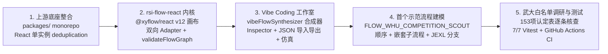
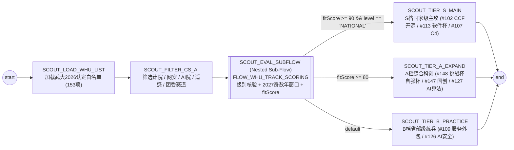

# RSI-Flow Scout · 第一周作业成果仓库

[](https://github.com/LosAveRoad/rsi-flow-scout/actions/workflows/ci.yml)
[](./LICENSE)
[](https://react.dev/)
[](https://reactflow.dev/)
[](https://www.typescriptlang.org/)
[](https://vitejs.dev/)

基于 [`ymxiong/rsi-flow-react`](https://github.com/ymxiong/rsi-flow-react) 与 [`ymxiong/rsi-flow-visual`](https://github.com/ymxiong/rsi-flow-visual) 构建的 **Vibe Coding 可视化工作流工作室** —— 集成自然语言流程合成、交互式画布编辑、静态拓扑校验、`rsi-flow` 标准 JSON 双向导出以及 **2026.11–2027.11 武汉大学学科竞赛白名单调研决策流程**。

---

## 一、第一周作业是什么（Week 1 Assignment）

根据课程/实验室本周安排（**任务 1 · 比赛同学路线，必做，满分 5 分**），第一周核心任务目标如下：

> **原题要求**：在 [`ymxiong/rsi-flow-react`](https://github.com/ymxiong/rsi-flow-react) 与 [`ymxiong/rsi-flow-visual`](https://github.com/ymxiong/rsi-flow-visual) 基础上，使用 **Vibe Coding** 设计出**第一个流程**，并**调研一年内适合参加的比赛**。

拆解为本仓库对应交付的三项具体产物：

1. **工程底座就绪（`packages/`）**：理顺并完善 `rsi-flow-react` 画布组件库与 `rsi-flow-visual` 可视化工作室工程，确保本地运行、双向 JSON 导出与自动化测试全通。
2. **第一个可运行/可仿真的示范流程（`workflows/`）**：利用 Vibe Coding 设计并验证仓库首个工作流 [`FLOW_WHU_COMPETITION_SCOUT`](./workflows/flow-whu-competition-scout.json) 及其嵌套子流程 [`FLOW_WHU_TRACK_SCORING`](./workflows/flow-whu-track-scoring.json)，形成“用工作流解决竞赛调研决策”的闭环示范。
3. **一年期（2026.11–2027.11）可参加赛事调研报告（`docs/`）**：结合官方竞赛白名单筛选未来一年高契合赛事、分级梯队与全年备赛节奏，沉淀至 [`docs/whu_competition_survey_2026_2027.md`](./docs/whu_competition_survey_2026_2027.md) 与 [`docs/stage1_summary_report.md`](./docs/stage1_summary_report.md)。

---

## 二、这个仓库是怎么完成的（How This Repository Was Built）

整体按照 **“双包工作区搭建 → 画布转换/校验内核修复 → Vibe Coding 工作室实现 → 首个业务流程建模 → 武大白名单校准与 CI 闭环”** 五步流水线完成：



### 1. 上游底座整合与 Monorepo 工作区配置
- 将 `rsi-flow-react`（组件库）与 `rsi-flow-visual`（交互应用）整合至同一工作区的 [`packages/`](./packages) 目录下，统一由根目录 [`package.json`](./package.json) 提供 `setup`、`dev`、`test`、`build` 一键命令。
- 由于 `rsi-flow-visual` 通过本地文件依赖 `file:../rsi-flow-react` 引用画布组件，我们在 Vite 与 Vitest 配置中使用 `resolve.dedupe` 与 `resolve.alias` 锁定 `react`、`react-dom`、`@xyflow/react` 单一实例，解决本地软链构建/单测时的上下文冲突，并配置 [`.github/workflows/ci.yml`](./.github/workflows/ci.yml) 在 Node 20 下自动先编译组件库再验证应用。

### 2. 实现 `rsi-flow-react` 画布、Adapter 与校验器
- 在 [`packages/rsi-flow-react`](./packages/rsi-flow-react) 中基于 `@xyflow/react` v12 与 `ReactFlowProvider` 实现 [`RsiFlowCanvas`](./packages/rsi-flow-react/src/components/RsiFlowCanvas.tsx)，内置 `StartNode`、`EndNode`、`EventNode`、`SubFlowNode`、`LoopNode` 与 `ConditionEdge` 自定义节点和条件边组件。
- 在 [`flowAdapter.ts`](./packages/rsi-flow-react/src/adapter/flowAdapter.ts) 中完成 **DAG 自动分层布局与双向无损转换**：
  - `flowConfigToGraph`：将兼容 `ymxiong/rsi-flow` 协议的 `FlowConfig` JSON 自动展开为带 `start`/`end` 虚节点的 React Flow 图；
  - `graphToFlowConfig`：将画布拖拽与属性修改实时序列化回标准 JSON；
  - `validateFlowGraph`：静态检查缺失流程 ID、悬空边引用或非法结构，返回 `{ valid, errors, warnings }`。

### 3. 通过 Vibe Coding 构建 `rsi-flow-visual` 工作室
- 通过 Vibe Coding 方式快速迭代出三栏式交互界面 [`App.tsx`](./packages/rsi-flow-visual/src/App.tsx) 与自然语言流程合成器 [`vibeFlowSynthesizer.ts`](./packages/rsi-flow-visual/src/vibe/vibeFlowSynthesizer.ts)：
  - **自然语言生成流程图**：用户输入需求 Prompt（或点击快捷示例），合成器自动识别领域模式（赛事调研 / 嵌套评分 / 材料复用 / 条件分支），拼装节点与路由并经 `validateFlowGraph` 强制校验后渲染上画布；
  - **属性检查器 & JSON 互通**：点击画布中的算子、子流程或边即可修改 `title`、`reference` 与 JEXL 条件表达式，并可通过“JSON 导入/导出”弹窗完成双向导入校验；
  - **执行仿真高亮**：提供“单步执行高亮”与“主路径全量仿真”，通过 `RsiRuntimeOverlay` 在画布节点实时显示执行步骤状态。

### 4. 设计仓库首个示范流程：`FLOW_WHU_COMPETITION_SCOUT`
- 把“面向团队筛选 2026–2027 比赛”的决策过程抽象为标准 [`FlowConfig`](./workflows/flow-whu-competition-scout.json) 工作流（同步预置在 [`presets/flows.ts`](./packages/rsi-flow-visual/src/presets/flows.ts) 中），覆盖 **顺序执行 + 嵌套子流程调用 + 多路 JEXL 条件分支** 三类典型编排原语：



### 5. 对照武大 2026 官方白名单核查比赛与自动化验证
- 逐条梳理《武汉大学本科生学科竞赛认定信息表（2026年）》全表 153 项赛事，修正了普通通用调研中常见的级别误判（如明确 **#109 中国大学生服务外包创新创业大赛** 在武大认定为**省部级**，而 **#102 CCF开源创新大赛**、**#113 中国软件杯** 等认定为**国家级**；同时锁定 2027 奇数年举办的 **#148 挑战杯“自强杯”**），编写完整调研规划 [`docs/whu_competition_survey_2026_2027.md`](./docs/whu_competition_survey_2026_2027.md) 与阶段一报告 [`docs/stage1_summary_report.md`](./docs/stage1_summary_report.md)。
- 为两个包补充了完备的 Vitest + React Testing Library 测试用例（[`adapter.test.ts`](./packages/rsi-flow-react/src/__tests__/adapter.test.ts) 与 [`studio.test.tsx`](./packages/rsi-flow-visual/src/__tests__/studio.test.tsx)），确认 `4 + 3 = 7` 项自动化测试及生产构建全部通过。

---

## 三、武大 2026–2027 推荐参赛清单摘要（S / A / B 梯队）

| 梯队 | 表内序号 | 赛事名称 | 武大认定级别 | 推荐学院/单位 | 适用切入点 |
|---:|---:|---|---|---|---|
| 🥇 **S 档** | **#102** | CCF开源创新大赛 | **国家级** | 计算机学院 | 直接以本工程与工作流底座核心参赛 |
| 🥇 **S 档** | **#113** | “中国软件杯”大学生软件设计大赛 | **国家级** | 遥感信息工程学院 | 智能体与低代码可视化编排企业赛题 |
| 🥇 **S 档** | **#107** | 中国高校计算机大赛（C4） | **国家级** | 计算机 / 网安 / 工创中心 | 人工智能创意赛 / 智能交互创新赛 |
| 🥇 **S 档** | **#104** | 全国大学生软件创新大赛 | **国家级** | 计算机学院 | AI 赋能软件工程（AI4SE）原生应用 |
| 🥇 **S 档** | **#106** | 中国大学生计算机设计大赛（4C） | **国家级** | 计算机学院 | 软件应用与开发 / 人工智能应用大类 |
| 🥈 **A 档** | **#148** | “挑战杯”课外学术科技作品竞赛（校赛：**自强杯**，奇数年） | **国家级** | 团委 | 科技发明制作类（2026.11 起立项校赛） |
| 🥈 **A 档** | **#147** | 中国国际大学生创新大赛（互联网+） | **国家级** | 团委 | 新工科主赛道 / 产业命题赛道 |
| 🥈 **A 档** | **#127** | 全球校园人工智能算法精英大赛 | **国家级** | 人工智能学院 | AI 应用与多步工作流智能编排 |
| 🥉 **B 档** | **#109 / #126** | 服务外包大赛 / 全国大学生人工智能安全竞赛 | **省部级** | 计算机 / 网安学院 | 春季首战练兵与工作流结构安全治理 |

> 完整 11 项高契合赛事时间轴、申报书简介模板与全年复用甘特表请参阅：[`docs/whu_competition_survey_2026_2027.md`](./docs/whu_competition_survey_2026_2027.md)  
> 阶段一技术实现与校验记录请参阅：[`docs/stage1_summary_report.md`](./docs/stage1_summary_report.md)

---

## 四、仓库目录结构 / Repository Layout

```text
rsi-flow-scout/
├── README.md                                   # 第一周作业说明、仓库构建全过程与快速开始指南
├── LICENSE                                     # All Rights Reserved 版权声明
├── package.json                                # 根工作区统一脚本 (setup / dev / test / build)
├── .github/workflows/ci.yml                    # GitHub Actions 自动测试与构建流水线
├── packages/
│   ├── rsi-flow-react/                         # @xyflow/react v12 交互画布组件、adapter 与校验器
│   └── rsi-flow-visual/                        # Vibe Coding 可视化流程工作室前端应用
├── workflows/
│   ├── flow-whu-competition-scout.json         # 主流程配置 JSON（顺序 + 嵌套子流程 + S/A/B 分支）
│   └── flow-whu-track-scoring.json             # 嵌套子流程 JSON（白名单级别与奇偶年校验）
└── docs/
    ├── whu_competition_survey_2026_2027.md     # 武汉大学 2026 白名单竞赛一年期调研规划
    └── stage1_summary_report.md                # 阶段一技术架构与测试验证总结报告
```

---

## 五、快速开始 / Quick Start

环境要求：**Node.js >= 18**（推荐 Node 20 LTS）与 **npm >= 9**。

```bash
# 1. 克隆仓库
git clone https://github.com/LosAveRoad/rsi-flow-scout.git
cd rsi-flow-scout

# 2. 一键安装依赖并先构建本地组件库 rsi-flow-react，再准备工作室环境
npm run setup

# 3. 启动本地 Vibe Coding 可视化工作室 (http://localhost:5173)
npm run dev
```

### 运行测试与生产构建

```bash
# 运行 rsi-flow-react (4 passed) 与 rsi-flow-visual (3 passed) 全部 Vitest 测试
npm test

# 构建组件库与工作室生产静态产物
npm run build
```

---

## 六、上游致谢与版权声明 / Attribution & Copyright

- **上游致谢**：本项目前端画布与工作室基于以下上游工作流项目设计扩展：
  - [`ymxiong/rsi-flow`](https://github.com/ymxiong/rsi-flow) —— Java 轻量级工作流编排引擎与 JSON 配置协议规范
  - [`ymxiong/rsi-flow-react`](https://github.com/ymxiong/rsi-flow-react) —— React 流程图可视化基础结构设计
  - [`ymxiong/rsi-flow-visual`](https://github.com/ymxiong/rsi-flow-visual) —— 可视化流程工作室原型底座
- **版权声明**：Copyright (c) 2026 LosAveRoad. **All Rights Reserved**（保留所有权利）。详见 [`LICENSE`](./LICENSE)。
