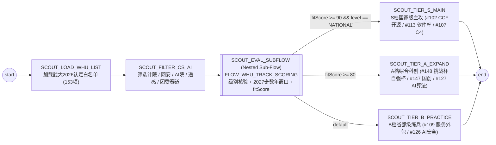

# RSI-Flow Scout · Vibe Coding Visual Studio

[](https://github.com/LosAveRoad/rsi-flow-scout/actions/workflows/ci.yml)
[](./LICENSE)
[](https://react.dev/)
[](https://reactflow.dev/)
[](https://www.typescriptlang.org/)
[](https://vitejs.dev/)

基于 **`rsi-flow-react`** 与 **`rsi-flow-visual`** 构建的 **Vibe Coding 可视化工作流编排工作室** —— 支持通过自然语言快速生成、可视化编辑、实时静态校验并双向导出兼容 Java 工作流引擎 [`ymxiong/rsi-flow`](https://github.com/ymxiong/rsi-flow) 的标准 `FlowConfig` JSON 定义，同时内置面向 **2026.11–2027.11 武汉大学学科竞赛白名单** 的首个完整示范流程。

> **An open-source Vibe Coding visual workflow studio** built on `@xyflow/react` v12 (`rsi-flow-react` + `rsi-flow-visual`), featuring natural-language workflow synthesis, live graph topology validation, primary-path simulation, bidirectional `rsi-flow` JSON compatibility, and a ready-to-run 2026–2027 Wuhan University competition scouting workflow.

---

## 核心特性 / Features

- **Vibe Coding 自然语言流式合成**：输入中文或英文业务需求（如“调研武大 2026 白名单国家级比赛并嵌套子流程评分后分支立项”），`vibeFlowSynthesizer` 自动识别算子、嵌套子流程与条件分支模式并生成可运行拓扑。
- **独立可复用的 React Flow 画布组件库（`packages/rsi-flow-react`）**：基于 `@xyflow/react` v12 封装，内置 DAG 自动分层布局、`flowConfigToGraph` / `graphToFlowConfig` 无损双向转换、交互式属性同步与执行态高亮叠层。
- **实时拓扑静态安全校验（`validateFlowGraph`）**：在画布编辑、JSON 导入与 Vibe 生成瞬间自动拦截空 ID、孤立或悬空路由引用、无保护循环结构，并在顶部状态栏实时反馈。
- **标准 `FlowConfig` JSON 双向兼容**：工作室画布与导出文件严格遵循 `ymxiong/rsi-flow` 核心 Schema，导出后可直接投入后端流程引擎装配运行。
- **武大 2026 官方白名单竞赛调研闭环**：内置《武汉大学本科生学科竞赛认定信息表（2026年）》153 项官方赛事校准结论、S/A/B 三档立项建议与全年甘特规划。

---

## 首个示范流程：`FLOW_WHU_COMPETITION_SCOUT`

项目围绕“**如何科学筛选 2026.11 — 2027.11 适合计算机/AI 方向参加的高含金量竞赛**”，通过 **顺序节点 + 嵌套子流程 + JEXL 多路条件分支** 设计了首个示范流程（源码见 [`workflows/flow-whu-competition-scout.json`](./workflows/flow-whu-competition-scout.json) 与嵌套子流程 [`workflows/flow-whu-track-scoring.json`](./workflows/flow-whu-track-scoring.json)）：



---

## 武大 2026–2027 推荐参赛清单摘要（S / A / B 梯队）

严格核对《武汉大学本科生学科竞赛认定信息表（2026年）》后修正了常见认定偏差（例如明确 **#109 服务外包在武大为省部级**、2027 奇数年正好覆盖 **#148 大挑“自强杯”**，开源主线直接对齐国家级 **#102 CCF 开源创新大赛**）：

| 梯队 | 表内序号 | 赛事名称 | 武大认定级别 | 推荐学院/单位 | 适用切入点 |
|---:|---:|---|---|---|---|
| 🥇 **S 档** | **#102** | CCF开源创新大赛 | **国家级** | 计算机学院 | 直接以本开源仓库为核心作品共建 |
| 🥇 **S 档** | **#113** | “中国软件杯”大学生软件设计大赛 | **国家级** | 遥感信息工程学院 | 智能体与低代码可视化编排企业赛题 |
| 🥇 **S 档** | **#107** | 中国高校计算机大赛（C4） | **国家级** | 计算机 / 网安 / 工创中心 | 人工智能创意赛 / 智能交互创新赛 |
| 🥇 **S 档** | **#104** | 全国大学生软件创新大赛 | **国家级** | 计算机学院 | AI 赋能软件工程（AI4SE）原生应用 |
| 🥇 **S 档** | **#106** | 中国大学生计算机设计大赛（4C） | **国家级** | 计算机学院 | 软件应用与开发 / 人工智能应用大类 |
| 🥈 **A 档** | **#148** | “挑战杯”课外学术科技作品竞赛（校赛：**自强杯**，奇数年） | **国家级** | 团委 | 科技发明制作类（2026.11 起立项校赛） |
| 🥈 **A 档** | **#147** | 中国国际大学生创新大赛（互联网+） | **国家级** | 团委 | 新工科主赛道 / 产业命题赛道 |
| 🥈 **A 档** | **#127** | 全球校园人工智能算法精英大赛 | **国家级** | 人工智能学院 | AI 应用与多步工作流智能编排 |
| 🥉 **B 档** | **#109 / #126** | 服务外包大赛 / 全国大学生人工智能安全竞赛 | **省部级** | 计算机 / 网安学院 | 春季首战练兵与工作流结构安全治理 |

> 完整 11 项赛事时间轴、申报书简介模板与全年复用甘特表请参阅：[`docs/whu_competition_survey_2026_2027.md`](./docs/whu_competition_survey_2026_2027.md)  
> 阶段一工程设计与测试验证详情请参阅：[`docs/stage1_summary_report.md`](./docs/stage1_summary_report.md)

---

## 仓库目录结构 / Repository Layout

```text
rsi-flow-scout/
├── README.md                                   # 项目主文档与快速开始指南
├── LICENSE                                     # Apache License 2.0
├── package.json                                # 根工作区统一脚本 (setup / dev / test / build)
├── .github/workflows/ci.yml                    # GitHub Actions 自动测试与构建流水线
├── packages/
│   ├── rsi-flow-react/                         # @xyflow/react v12 交互画布组件、adapter 与校验器
│   └── rsi-flow-visual/                        # Vibe Coding 可视化流程工作室前端应用
├── workflows/
│   ├── flow-whu-competition-scout.json         # 主流程配置 JSON（顺序 + 嵌套子流程 + S/A/B 分支）
│   └── flow-whu-track-scoring.json             # 嵌套子流程 JSON（白名单级别与奇偶年校验）
└── docs/
    ├── whu_competition_survey_2026_2027.md     # 武汉大学 2026 白名单竞赛一年期调研规划
    └── stage1_summary_report.md                # 阶段一技术架构与测试验证总结报告
```

---

## 快速开始 / Quick Start

环境要求：**Node.js >= 18**（推荐 Node 20 LTS）与 **npm >= 9**。

```bash
# 1. 克隆仓库
git clone https://github.com/LosAveRoad/rsi-flow-scout.git
cd rsi-flow-scout

# 2. 一键安装依赖并先构建本地组件库 rsi-flow-react，再准备工作室环境
npm run setup

# 3. 启动本地 Vibe Coding 可视化工作室 (http://localhost:5173)
npm run dev
```

### 运行测试与生产构建

```bash
# 同时运行 rsi-flow-react (4 passed) 与 rsi-flow-visual (3 passed) 全部 Vitest 测试
npm test

# 构建组件库与工作室生产静态产物
npm run build
```

---

## 上游致谢 / Acknowledgements

本项目前端画布与工作室基于以下上游工作流开源项目生态扩展构建：

- [`ymxiong/rsi-flow`](https://github.com/ymxiong/rsi-flow) —— Java 轻量级工作流编排引擎与 JSON 配置协议规范
- [`ymxiong/rsi-flow-react`](https://github.com/ymxiong/rsi-flow-react) —— React 流程图可视化基础结构设计
- [`ymxiong/rsi-flow-visual`](https://github.com/ymxiong/rsi-flow-visual) —— 可视化流程工作室原型底座

## 开源协议 / License

本项目基于 [Apache License 2.0](./LICENSE) 开源发布。
